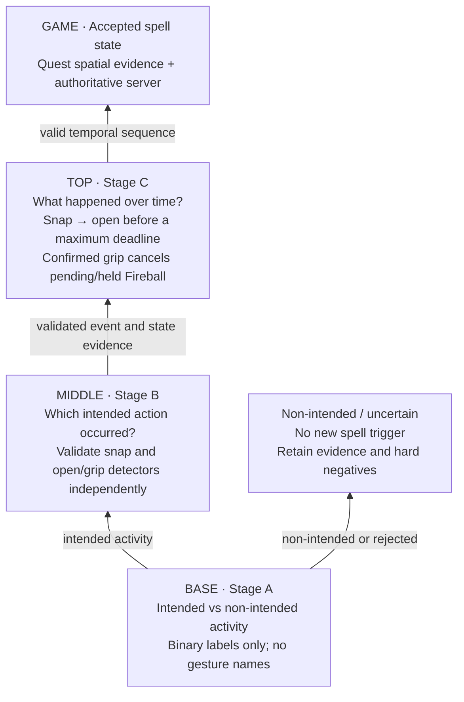

# Spell-Casting Game: System Architecture Spec

**For Sophie — the Neuroband training architecture is a pyramid, built from
the bottom up: (A) intended versus non-intended activity → (B) independently
validated action detectors → (C) learned temporal transitions → game actions.**
Read **Our Methodology for Training Our Neuroband EMG (§2.2.1)** before changing
the classifier or collection workflow. These are successive problems with
separate labels and evaluations; do not start by fitting whole spell sequences.

Diagram: https://www.tldraw.com/f/j9TtJhe8cWZyB6hVz3jwV?d=v-977.-580.3038.1929.page

**How to read this spec:**
- **Binding:** the shape of the system:
  - which components exist and what each one is responsible for;
  - what flows between them (§3);
  - the transports, including TCP for game traffic and the UDP discovery beacon (§4, §4.1);
  - the server-authoritative model;
  - the shared player ID (§5);
  - Python tooling: `uv` for every Python package (§2).
  
  Any implementation must preserve these.
- **Recommended, not binding:** the libraries and implementation choices in the **Stack** and **Data collection** items of §2.2 (classifier) and §2.3 (server). Swap them out if something else works better.
- **(default):** values that are proposed starting points rather than decisions, such as ports, framing, message fields, and rates. Change them freely.

## 1. Overview

A multiplayer mixed-reality (passthrough AR) spell-casting game.

- **Meta Quest 3** tracks each player's body.
- **Meta Neural Band** reads the player's forearm EMG, and an ML classifier on a Mac turns it into hand signs.
- **One authoritative game server** on a Mac combines both inputs, runs all game mechanics, and sends the resulting state back to every headset.

There is one Quest, one Neural Band, and one classification Mac per player, plus one shared server Mac. Everything runs on one local network.

## 2. Components

**Python tooling:** every Python package (the game server, the hand-sign client, and any tools) uses [`uv`](https://docs.astral.sh/uv/) as its package manager and for its environment. Declare dependencies in `pyproject.toml`, commit the `uv.lock`, and run things through uv (`uv sync`, `uv run …`, `uv add …`) instead of `pip` and hand-made `venv`s.

### 2.1 Meta Quest 3: AR client (Unity, passthrough; called the VR client / role `vr` in code and protocol)
- **Inputs:**
  - Built-in camera tracking through Meta's Movement SDK (full-body tracking, legs estimated): hands, wrists, elbows, shoulders, chest, hips, knees, ankles, feet.
- **Responsibilities:**
  - Find the game server on the LAN (§4.1), then open a TCP connection to it.
  - Stream position/pose packets (body and arms) to the server.
  - Receive **all** game-state packets (pose, hand sign, damage) and render them.
  - Process **no** game mechanics.
  - Show the real room through passthrough; players see each other's real bodies, so skeletons are debug lines only. The local skeleton comes from local tracking, other players' from the server.
- **Identity:** tagged with a player ID (§5).

### 2.2 Hand sign classification client (Mac, one per player)
- **Inputs from the Neural Band** (via Axo's Kinesis app, Bluetooth → Kinesis → local feed):
  - Raw EMG: 8 channels, 2,048 Hz, 16-bit unsigned ADC counts, sent in batches of 16 samples. The values are uncalibrated and unfiltered.
  - Wrist rotation quaternion `[w, x, y, z]`, ~128 Hz.
  - Also available but optional: gyro, and the band's built-in decoded gestures, which make a useful baseline or fallback.
- **Data access:**
  - Kinesis serves Server-Sent Events at `http://127.0.0.1:8766/events?token=…`.
  - The feed is loopback-only, so the classifier **must run on the same Mac as Kinesis**.
  - Kinesis allows at most 4 readers per feed.
  - A slow reader is disconnected, so read the feed on a dedicated thread.
  - The URL and token change every time the feed is restarted.
- **Responsibilities:**
  - Run the two-stage intent and gesture pipeline described in §2.2.1 on causal windows of EMG, with available wrist orientation/gyro as measured context.
  - Find the server (§4.1) and open a TCP connection to it.
  - Send **current hand sign** packets to the server.
  - **Optional:** send **wrist orientation** packets, used only if the headset's arm tracking proves inaccurate. The band provides rotation only, not position.
- **Identity:** tagged with the **same player ID** as that player's Quest (§5).
- **Requirements:** macOS 14+ on Apple Silicon (for the packaged Kinesis build), and the band paired and enrolled via Meta sign-in in Kinesis.
- **Stack (recommended):** Python 3. Compare classical EMG features against a small causal temporal network using the same wearing-session splits; select by measured false triggers, missed actions and latency.
  - **Feed reader:** standard-library `urllib` reading the SSE stream line by line, on its own thread, pushing EMG batches into a ring buffer (`collections.deque` or a preallocated `numpy` array).
  - **Preprocessing (`scipy.signal`):**
    - Subtract the per-channel mean (the raw counts are unsigned and not centered).
    - Band-pass 20–450 Hz (`butter` + `sosfilt`).
    - Notch at 60 Hz (`iirnotch`).
    - Use streaming filters with persistent state (`sosfilt` with `zi`) so windows join without edge artifacts.
  - **Windowing:** ~150–250 ms windows with a ~50 ms hop, giving a prediction every 50 ms.
  - **Features (`numpy`):** per channel, RMS, mean absolute value, waveform length, zero crossings, and slope-sign changes (8 × 5 = 40 features). Optionally append the wrist quaternion.
  - **Model (`scikit-learn`):**
    - Baseline: LDA.
    - Next to try: `RandomForestClassifier` or `LogisticRegression`.
    - Wrap scaling and the model in a `Pipeline`; save and load it with `joblib`.
  - **Output smoothing:** a majority vote over the last 3–5 predictions plus a confidence threshold before a `sign` packet changes. This is our own code, not a library.
  - **Debug plotting:** `pyqtgraph` for live 8-channel plots; `matplotlib` for offline analysis.
  - **Temporal candidate:** a small causal 1D CNN, optionally followed by a GRU, in `PyTorch`. Compare it with the feature baseline rather than assuming a larger model will improve this dataset.
- **Data collection (recommended):**
  - A recording script prompts the player ("make sign X") and saves labeled windows to `.npz` files, including rest and `none` samples.
  - Recalibrate every session, because the EMG shifts whenever the band is taken off and put back on.

### 2.2.1 Our Methodology for Training Our Neuroband EMG

**For Sophie.** This is the proposed training methodology and collection
contract. The localhost collector supports gathering evidence for it; the
two-stage trained pipeline is not yet deployed. The preserved v4 model and the
game hand-client's current `EmgLogger` stub do not implement this methodology.

#### For Sophie: build the pyramid from its base, in this order

**The base is intent detection, not gesture recognition. The next layer learns
individual actions, not spells. Only the third layer learns whether those
actions form a valid transition over time.** Each layer depends on the one
below it being measured and understood. A sophisticated transition model cannot
repair a snap detector or open-hand detector that has not been independently
validated.



**For Sophie: do not collapse A, B and C into one labeling task.** Stage A asks
only whether the participant intended an interaction; Stage B adds action
identity; Stage C uses longer sequences and reviewed times to learn the
transition. Preserve separate datasets/targets and report errors at each layer
as well as across the complete cascade. Collecting a transition clip does not
make the lower-level action labels reliable automatically.

#### Stage A: intended versus non-intended activity

First build a binary dataset with only two reported classes: **intended
interaction** and **non-intended everyday movement**. At this stage the person
does not label which gesture they performed. The question is whether they were
deliberately attempting an interaction. This is a behavioral label supplied by
the participant, not intention read directly from a camera or muscle sensor.
Uncertain or incorrectly performed blocks remain unconfirmed.

For continuous collection, use one live toggle: **red/off = non-intended;
green/on = intended**. Keep the webcam observing in both states. Preserve every
toggle timestamp and software clock uncertainty, but do not train directly up
to a button boundary. Exclude a configurable guard on **both sides** of toggles,
other reported UI interactions and recording boundaries (initial default: one
second each side), and intersect the remainder with continuous sensor coverage.
Prefer clicking with the other hand. Guarded intervals remain participant
reports; clicking is not an exact physiological onset or a guarantee of intent.

The current **Micah data contribution** page is an independent, EMG-only Stage A
collector, without camera validation or inference. It also records available timestamped band motion/context for alignment and later analysis. Start with the mouse, select
Snap or a low/medium/high Shield/Sword hold, then **hold Space for intended
activity and release for non-intended**. These motion selections are participant
metadata, separate from the binary target; they need not be used to fit the
initial intent gate. Space changes the reported label immediately, with **no
activation delay, fixed clipping or minimum interval**. Preserve every boundary
and the surrounding non-intended baseline; refine actual motion boundaries in
a separate postprocessing step. Keep sensor coverage and clock uncertainty
separate from participant intention reports. Prefer the other hand for Space.
Data and participant truth reports stay in the Git-ignored
`Micah data contribution/` folder. See
[`docs/micah-contribution.md`](docs/micah-contribution.md). The older continuous
toggle and optional camera workflow remain available at `/collect`.

Collect intended interactions with varied arm positions, continuously varying
wrist rotations, and relaxed, natural and comfortably firm effort. Collect
equally varied non-intended activity: resting, finger fidgeting with a still
wrist, wrist rotation without an action, reaching, whole-arm movement, ordinary
gripping, walking and natural arm swing. Include visually similar movements in
both classes where their intended use differs; do not accidentally teach the
model that motion or strong muscle tension always means intent. If the signals
do not distinguish a particular pair, report that ambiguity rather than
inventing separability.

Record continuously and retain all raw evidence, including the lead-in and
transitions. Start with a classical feature baseline and compare a compact
causal 1D CNN; test a CNN plus GRU if temporal context helps. Learn a score for
intended activity with an uncertainty/rejection region. Fit preprocessing on
training data only and choose thresholds on separate validation sessions.
Measure false openings of the gate per minute of ordinary activity, missed
intended interactions, and detection delay, rather than selecting on aggregate
window accuracy alone.

#### Stage B: classify the intended action and verify its trigger

After Stage A is evaluated, collect a second, gesture-labeled dataset for
intended activity. Learn which action occurred, separately from whether it was
intended. Preserve the intended/non-intended labels and original timelines;
Stage A and Stage B have distinct targets and versioned models. Non-intended
examples remain useful hard negatives and must remain in end-to-end evaluation.
Do not throw them away merely because Stage A predicts they are non-intended.

At runtime, the conceptual path is **continuous sensor history → intent gate →
gesture/event classification → temporal trigger rules → authoritative game
server**. Maintain a causal pre-trigger buffer so gate latency does not remove
the beginning of a snap. Evaluate the whole cascade: an otherwise correct
gesture detector cannot recover an intended action that the gate rejects.

Train **snap events** independently from **held hand states**. A short snap is
not a five-second hand pose. Collect true snaps at arbitrary, continuously
varying wrist/arm angles and with relaxed, natural and comfortable firm effort;
also collect missed attempts, finger/thumb touches, wrist sweeps, finger
fidgeting and arm/walking motion without snaps. Report actual counts, including
zero, rather than equating a prompt with success. Counts provide weak clip
labels; precise positive target pulses require reviewed event timing.

#### Stage C: temporal equipment rules — snap, open hand, then grip

1. A detected intentional snap starts a short **pending-open** interval; it does
   not by itself establish a held Fireball.
2. A clearly open hand shortly afterward confirms **Fireball equipped**. Palm-up
   is not required. There is **no minimum snap-to-open delay**: immediate
   opening can be valid. Independently validate the snap detector and open-hand
   detector first. Then collect longer sequences ranging from the shortest
   natural snap→open transition to the longest acceptable one, plus no-opening
   controls. Use reviewed times and separate validation data to select a
   **maximum opening deadline**, rather than assuming one delay works.
3. If no open hand is confirmed within that interval, discard the pending
   Fireball. A new snap is required. Missing or ambiguous evidence is not proof
   that a grip occurred.
4. A confirmed clasp/grip during the pending interval or while holding Fireball
   selects **Sword**, without requiring a spatial draw gesture. Confirmation
   must be quick enough for gameplay and stable enough to resist false grips;
   measure the tradeoff on reviewed open↔grip transitions.
5. Once equipped, Fireball persists through open-hand movement and uncertain
   hand readings until a grip is confirmed or an explicit game rule applies.
   A low intent-gate score alone must not silently erase held equipment. Keep
   contextual held-state monitoring active after initial trigger acceptance.
6. Quest supplies spatial evidence for deployment/throwing, hand position and
   palm direction. It does not replace the participant's intent label. Spell
   state and hit/damage rules remain server-authoritative.

The existing game simulation still contains earlier sword/shield semantics;
these rules describe the target behavior and localhost preview. Integrating
them into the multiplayer server requires an explicit coordinated change.
The tension/effort model can be retained as a baseline while snap/intent and
transition models are developed; no improvement claim follows from retaining it.

#### Synchronized evidence and faster vision-assisted review

Capture every sensor stream Kinesis actually exposes: raw eight-channel EMG,
wrist orientation, gyro, decoded band gestures, stream configuration and
connection changes. Retain original sample/sequence identifiers and band
timestamps plus host receipt uptime. Mark unavailable streams explicitly. The
raw recording-file path currently supplies only EMG; the full local feed is
needed for motion context. The band measures wrist orientation, not absolute
finger pose, hand position or directly calibrated physical force.

Use a computer webcam facing the participant, with the band hand visible, for
independent hand/finger measurements. The current implementation uses locally
cached MediaPipe hand landmarks; a suitably trained YOLO hand-keypoint model can
be evaluated as an alternative. A generic person detector is insufficient.
Store visual open/grip proposals, landmarks, uncertainty and occlusions alongside
synchronized video and optional snap-review audio. Correct the hand selection
for mirrored previews. Quest hand tracking can later add spatial reference.

Vision should automatically propose hand-state intervals and prioritize
disagreements for review, reducing per-frame button clicks. It cannot certify
mental intent or precisely locate every snap. Keep **cues**, **model
predictions**, **vision-derived proposals**, and **participant/reviewer-confirmed
labels** as separate fields. Record software clock alignment and uncertainty;
do not claim hardware synchronization. Review uncertain finger motion and snap
timing before using them as supervised targets. Camera observations are label
references, not inputs to the deployed band classifier.

Include 10-second stable open-hand and grip holds, quiet finger movement,
continuous wrist rotation, moving open holds, snap→immediate grip, snap without
opening, and snap→open→grip at variable speeds. These establish steady-state
variation and temporal failure cases. An open Fireball hold must not silently
inherit an old deliberate-shield label.

#### Fresh data, splits and model acceptance

Start new intent and action training from freshly collected labels. Exclude
historical training data by default; retain the old models and data as archived
baselines rather than deleting or silently relabeling them. Reuse historical
examples only after an explicit provenance/label review confirms that their
meanings and synchronization match this methodology. Historical raw data are
not distributed with this repository.

Group by original clip and complete wearing session. Never split overlapping
windows from one clip across training and evaluation. Use separate sessions for
fitting, validation/threshold selection, and untouched testing, including band
removal/reapplication and ordinary motion. Preserve evaluation captures from
training and hard-negative mining. Recording never updates live weights.

Compare the frozen cascade with the preserved baseline on event precision and
recall where reviewed timing exists, false spell triggers per minute, missed
actions, grip-switch/open-confirmation latency, rejection coverage, and results
across continuously measured rotations and effort levels. Count matching alone
does not establish event accuracy. Promote a versioned candidate only after
these checks; 99% remains a target, not an established result.

The localhost procedure and saved-file contract are documented in
[`docs/intent-lab.md`](docs/intent-lab.md).

### 2.3 Game server (Mac)
- **Authoritative.** Runs the entire game simulation; clients only send inputs and render state.
- **Responsibilities:**
  - Accept TCP connections from all VR clients and classification clients.
  - Merge each player's pose stream and hand sign stream using the shared player ID.
  - Track the state of complex spells, such as charge-ups that span several frames or several signs.
  - Resolve hits and damage.
  - Broadcast all packets (pose, hand sign, damage) to every VR client.
  - Run the UDP discovery beacon (§4.1).
- **Scale:** 2 players, so performance is not a constraint.
- **Stack (recommended):** Python 3 with `asyncio`, using the standard library.
  - **Why:** the classifier is also Python, so both can share one `protocol.py` (message dataclasses plus JSON encode/decode) and the message format can't drift between them.
- **Structure:**
  - `asyncio.start_server` handles TCP connections, with one reader task per connection that writes into per-player latest-state slots.
  - A fixed-tick loop: `step()`, then broadcast, then `await asyncio.sleep(dt)`.
  - An `asyncio` `DatagramProtocol` runs the discovery beacon.
  - Everything is single-threaded, so no locks are needed.
  - Game logic is a pure function `game_state.step(inputs, dt) -> events`, kept separate from networking, so spell and charge logic can be unit-tested with fake inputs.
- **Libraries:**
  - `numpy` for vector math in hit detection (swept spheres and capsules tested against the target's per-body-part hitboxes, §9.1).
  - `dataclasses` or `pydantic` for the message schema.
- **Alternatives:**
  - **C# / .NET console app:** lets the server share message classes with the Unity client, but loses code sharing with the classifier.
  - **Headless Unity build:** worth it if hit detection needs real geometry, such as walls, shield colliders, or projectiles colliding with the arena, because it gets Unity's physics engine. The cost is slower iteration.

### 2.4 Meta Neural Band
- A wrist-worn surface-EMG band (it reads muscle signals, not brain signals).
- Pairs with the classification Mac over Bluetooth through Kinesis. It does **not** connect to the Quest.

## 3. Data flows

| # | From → To | Transport | Payload | Rate |
|---|---|---|---|---|
| F1 | Quest cameras → VR client | On-device SDK | Hand pos/dir, wrists, elbows, shoulders, chest | Tracking rate |
| F2 | Neural Band → Kinesis (Mac) | Bluetooth | EMG, wrist quaternion, gyro, gestures | 2,048 Hz EMG / 128 Hz motion |
| F3 | Kinesis → classifier | HTTP SSE on loopback | Same as F2, as timestamped JSON | Same as F2 |
| F4 | VR client → server | TCP | Position/pose packet | 30–60 Hz **(default)** |
| F5 | Classifier → server | TCP | Current hand sign packet | On change, plus 10 Hz heartbeat **(default)** |
| F6 | Classifier → server *(optional)* | TCP | Wrist orientation packet | 30–60 Hz **(default)** |
| F7 | Server → every VR client | TCP | All state: pose, hand sign, damage | Server tick, 30–60 Hz **(default)** |
| F8 | Server → LAN | UDP broadcast | Discovery beacon | 1 Hz |

## 4. Networking

- **Transport:**
  - All game traffic is **TCP over LAN**.
  - The **only** exception is the discovery beacon, which is UDP broadcast.
  - Set `TCP_NODELAY` on every socket.
- **Framing (default):** newline-delimited JSON, one message per line.
- **Ports (default):** UDP `47777` for discovery, TCP `9100` for game traffic (not 9000: Quest OS blocks outgoing connections to that port).
- **Network:** use a dedicated travel router or a laptop hotspot. Venue Wi-Fi often blocks device-to-device traffic (client isolation), which would kill both the TCP connections and the broadcast.

### 4.1 Server discovery
1. The server broadcasts `SPELLGAME <tcp_port>` to `255.255.255.255:47777` once per second.
2. Each client listens on UDP 47777 and takes the server IP from the packet's **sender address** and the port from the payload.
3. The client then connects over TCP.
4. The Quest client may need an Android `WifiManager.MulticastLock` to receive broadcasts.
5. Every client keeps a manual IP entry as a fallback.

### 4.2 Connection handshake (default)
The first message on every TCP connection:
```json
{"type":"hello","role":"vr"|"classifier"}
```
- **VR client:** the server replies `{"type":"welcome","player_id":"P1"}`.
- **Classifier:** the server replies `{"type":"welcome","player_id":null}`, then sends `{"type":"paired","player_id":"P1"}` once pairing completes (§5).
- While a classifier is unpaired, it sends only `pinch` messages and no `sign` packets.

## 5. Player identity

- Every player has one ID, shared by their VR client and their classification client.
- The server uses this ID to link the two streams to one player.
- The server gives each joining headset the lowest free player ID: `P1`, `P2`, and so on. Each headset shows its own ID. A relaunched app gets its old ID back (matched by `device.id`; a connection left over from the previous launch is dropped), and IDs nobody uses any more are reused, so restarting for testing doesn't make the numbers climb.
- **Pairing a Neural Band with a headset** uses **pairing mode** (the "Pair Neural Bands" screen):
  - Triggered from the game server's monitor (`p`), a headset (hold X+Y on the left controller for 3 s), or by any other connected client (headset or classifier) sending `pair_start`.
  - The server sends `pair_start`, then `pair_prompt` naming the first headset without a band (in join order): that player pinches their fingers.
  - The next unpaired classifier to report a `pinch` (using the band's built-in decoded `gesture` events, so no trained model is needed) is paired with the prompted player. The server then prompts the next headset without a band, and so on.
  - If the prompted headset disconnects, the server moves on to the next one. Pairing mode ends once every connected headset has a band; a headset that joins later needs pairing mode started again.
  - A `pinch` outside pairing mode is ignored.
- Classifier clients connect **unpaired** and receive their player ID from the server once paired. A classifier that reconnects with its `player_id` in `hello` pairs straight back to that player.

### 5.1 Shared room frame

Both headsets share one physical room, so every pose, projectile and hit has to be in one coordinate frame. Each Quest tracks in its own frame, with its own origin wherever it booted. Co-located Quest games handle this with Meta's **Shared Spatial Anchors**: one headset places an anchor and shares it, every headset localizes that same physical anchor, and each one moves its tracking space so the anchor becomes its origin ([Meta: Shared Spatial Anchors](https://developers.meta.com/horizon/documentation/unity/unity-shared-spatial-anchors/), [Colocation Discovery](https://developers.meta.com/horizon/documentation/unity/unity-colocation-discovery/)).

- **Alignment happens on the headset; the server never transforms poses.** Every `pose` the server receives is already in the shared frame (Unity's: left-handed, +y up, +z forward, metres, origin at the anchor on the floor).
- **The server coordinates it:**
  - It picks the **anchor host**: the first connected headset. The host keeps the role until it disconnects; then the next headset in join order takes over.
  - It sends each headset a `space` message on join and whenever the host or anchor changes. The message has the Meta group UUID, the host, the current anchor (if any) and that player's floor spot.
- **Floor marker (default).** Print `docs/center-marker.png` (a QR code encoding `SPELLGAME-CENTER`) and tape it flat in the middle of the room, with its arrow pointing to P2's side.
  - After **I'm ready**, each player looks down at the marker. MRUK tracks the QR code (this needs the spatial data permission). Once it has been tracked for 1.5 s, its averaged center becomes the origin (its height is the floor) and its top becomes +z. The headset then sends `aligned` with `method: marker`. Nothing to press.
  - The server keeps players ready but holds the countdown until both fighters are aligned. A recenter or `space_reset` clears the alignment, and the headset re-locks as soon as it sees the marker again.
- **Center calibration (fallback where QR tracking is unavailable).** Needs no internet and no measuring. Anchors are off unless `useSharedAnchors` is set on `SharedSpaceAligner`.
  - Both players meet in the middle of the room facing each other, touch their right controller tips together (each pointing at the other) and click the left thumbstick. They don't have to click at the same moment.
  - Each headset averages its right controller's tip over 0.3 s. The tip, dropped to the floor, becomes the origin; the controller's horizontal pointing direction becomes the player's `spot_yaw` (P1 +z, P2 -z). The headset then sends `aligned` with `method: center`.
  - The versus ready screen shows these steps, and **I'm ready!** stays unavailable until the headset is calibrated. Clicking again recalibrates; a system recenter clears it.
- **Anchor flow (optional, `useSharedAnchors`):**
  1. The host creates an `OVRSpatialAnchor` on the floor between the players (its +z pointing from P1 towards P2), saves it, and calls `ShareAsync` with the `group_uuid` from `space`.
  2. The host sends `anchor_shared` with the anchor's UUID. The server announces it in `space` to every headset.
  3. Every headset, including the host, loads the anchor from the group and aligns its tracking space to it: Meta's `Alignment.cs` sample, or MRUK's `SetCustomWorldLockAnchor`. Then it sends `aligned` with `method: anchor` and the anchor's UUID.
     Alignment takes the anchor's full position (height too) and its yaw, so the host's floor becomes every headset's floor. A system recenter moves the tracking origin, so a headset that recenters aligns to the anchor again and re-sends `aligned`.
  4. The server rejects `anchor_shared` from a headset that isn't the host. It also rejects an `aligned` naming any anchor other than the current one. A newly shared anchor clears every headset's aligned flag.
- **Marked floor spots (server and `fake_vr` only).** Headsets no longer offer this method; use center calibration instead.
  - Mark the two spots on the floor `--spot-distance` apart (default 3 m). P1 stands at `(0, 0, -d/2)` facing +z; P2 stands at `(0, 0, +d/2)` facing -z.
  - Each player stands on their spot, faces the indicated way, and recenters. The headset offsets its tracking space by `spot_pos`/`spot_yaw` and sends `aligned` with `method: floor_spots`.
  - Mixing the two methods gives two different frames, so the server logs a warning when that happens.
- **Re-anchoring:** press `a` in the server monitor, or have any client send `space_reset`. This drops the anchor, makes a new group UUID, clears every aligned flag and announces a fresh `space`. Use it after a headset lost tracking or the anchor drifted.
- `state.players[].aligned` shows each headset whether the others are aligned. Until both players are aligned, their poses aren't comparable, and fireball and sword hits between them are meaningless.

### 5.2 Match flow

The server owns the match; every `state` carries it as `match`.

- **Phases:** `lobby` → `match_setup` → `ready` → every fighter sent `ready` → `countdown` (3 s) → `playing` → `ended` → `rematch` (back to `ready`) or `match_quit` (back to `lobby`).
- **Modes:** `solo` pairs the headset that set the match up with the AI opponent (player ID `AI`, always ready). `versus` takes the first two connected headsets in join order; anyone else watches.
- **Length:** `duration_s`, 60/120/300 s from the menu (the server clamps to 10–600 s).
- **Rules:** `sword_only` (menu: Rules → Sword only) drops every sign but the fist for the match, so there is no fireball, shield or domain expansion; in solo the AI follows you at blade's reach and slashes instead of throwing.
- **Rules:** a KO ends the match at once. At time-out the higher HP wins; a tie goes to sudden death (`time_left` stays 0, next hit wins). A fighter's headset disconnecting ends it for the other (`reason: disconnect`), and `match_quit` from either fighter ends it with no winner (`reason: quit`, `ended_by`).
- **Spells:** in `lobby` and `ready` they're free practice, and a defeated player respawns at full HP. When the countdown starts the fighters' HP, items and cooldowns reset and projectiles clear. Nobody can cast during the countdown or on the results screen, and spectators can't cast while a match is playing.
- **AI opponent** (`spellgame/ai.py`): exists from `ready` to the end of a solo match. It stands 2.5 m in front of its target, strafes, throws a fireball every 2–3 s with a little aim error, and sometimes raises its shield against an incoming one. Its poses go through the same pipeline as a headset's (broadcast as `pose` with `player_id: AI`), so every spell view renders it.

## 6. Message types (default schema)

| Type | Direction | Fields |
|---|---|---|
| `hello` / `welcome` / `error` | client ↔ server | see §4.2. `hello` may carry an optional `player_id`: a VR client reclaims its ID after a reconnect; a classifier pairs directly with that player. It may also carry `device: {name, model?, id?}`, shown in the server's monitor |
| `pinch` | classifier → server | `t`, `hand` (sent while unpaired; acted on only during pairing mode, §5) |
| `pair_start` | any client → server, server → VR and classifier | starts pairing mode (§5); the server echoes it to every client when pairing mode starts |
| `pair_prompt` / `paired` | server → VR and classifier | `pair_prompt`: `player_id` currently being prompted (sent to every client); `paired`: `player_id` (sent to every headset and to the newly paired classifier) |
| `space` | server → VR | `group_uuid` (Meta colocation group to share and load the anchor through), `host_id` (the headset that creates and shares the anchor), `anchor_uuid` (null until shared), `spot_pos:[x,y,z]` and `spot_yaw` (degrees, 0 = +z): this headset's floor spot for the fallback (§5.1) |
| `anchor_shared` | VR (anchor host) → server | `anchor_uuid` |
| `aligned` | VR → server | `method` (`anchor` or `floor_spots`), `anchor_uuid` (required for `anchor`): this headset now sends poses in the shared frame |
| `space_reset` | any client → server | re-anchor from scratch (§5.1) |
| `pose` | VR → server, server → VR | `player_id`, `t`, `joints{head, chest, hips, l/r_shoulder, l/r_elbow, l/r_wrist, l/r_hand, l/r_knee, l/r_ankle, l/r_foot}` each `{pos:[x,y,z], rot:[w,x,y,z], vel?:[x,y,z]}`. Legs come from full-body tracking (estimated by the Quest runtime) and are for debugging and display only; `vel` (optional, measured on the headset) gives cleaner hand speed than the server's finite difference |
| `sign` | classifier → server | `player_id`, `t`, `hand` (`left`/`right`, the hand wearing the band), `sign` (`fist`, `open_palm`, `snap`, `infinite_void` or `none`), `confidence`. `snap` is momentary: the server acts on the transition into it; `infinite_void` held for 2 s (`Tuning.domain_void_hold_s`) expands the player's domain, like `domain_expand` |
| `tension` | classifier → server | `player_id`, `t`, `hand`, `value` (0 relaxed – 1 this player's comfortable max, from their own calibration), `calibrated`. About 20 Hz. PLACEHOLDER signal (`handclient/tension.py` guesses it from raw EMG RMS) until the band's real tension data is known. The server scales damage ×0.85–1.15 and the shield fade with it (`Tuning.tension_*`); uncalibrated → neutral |
| `calibrate` | VR → server → that player's classifier | (none). Restarts the grip calibration; it also runs automatically when the band first pairs |
| `calibration` | classifier → server → every VR | `player_id`, `phase` (`rest` → `squeeze` → `palm` → `done`/`failed`), `progress` (0–1 in the phase). The headset shows "Relax your band hand" / "Make a fist, comfortably firm" / "Shield hand: palm out, comfortably firm" |
| `wrist` *(optional)* | classifier → server | `player_id`, `t`, `hand`, `rot:[w,x,y,z]` |
| `spell` | server → VR | `caster_id`, `spell`, `state` (`charging`/`cast`/`cancelled`/`sheathed`), `charge` (0–1), `origin`, `direction`. Lifecycle events; continuous state is in `state`. Fireball: `charging` on snap, `cast` on throw, `cancelled` on fizzle. Sword: `cast` on draw, `sheathed` on release |
| `state` | server → VR, every tick | `tick`, `players[{player_id, hp, connected, band_paired, sign, item, band_hand, cooldown, shield_boost, aligned, max_hp}]` (`max_hp`: starting HP, so clients scale HP bars without copying `Tuning`; `aligned`: the headset reported it is in the shared room frame, §5.1; `cooldown`: seconds until the player can conjure again; `shield_boost`: 0–1 push power, a sword contact at ≥ 0.3 is a parry), `projectiles[{id, kind, owner_id, pos, vel}]`, `match{phase, mode, duration_s, time_left, countdown, fighters, ready, sudden_death, winner, reason, ended_by, ai_id, sword_only}` (§5.2) |
| `match_setup` | VR → server | `mode` (`solo` vs the AI, or `versus`), `duration_s` (the menu offers 60, 120, 300), `sword_only` (default false): set up the next match and wait for ready (§5.2) |
| `ready` | VR → server | `ready` (bool), on the ready screen |
| `match_quit` / `rematch` | VR → server | `match_quit` ends a running match early, or leaves the ready or results screen for the lobby; `rematch` on the results screen goes back to ready with the same settings |
| `domain_expand` | VR → server | none: the player held B on the right controller for 4 s to expand their domain (Infinite Void) |
| `domain_expansion` | server → VR | `caster_id`, `target_ids`, `expand_s` (streaks reach the targets after this), `stun_s` (targets then can't attack for this long; they can't attack from the cast on). One runs at a time; a stunned player can't cast one |
| `impact` | server → VR | `projectile_id` (0 for sword contacts), `kind`, `owner_id`, `pos`, `reason` (`hit`/`blocked`/`expired` for fireballs; `blocked`/`parried` for swords), `target_id` (player hit or shielding) |
| `damage` | server → VR | `target_id`, `source_id`, `amount`, `hp_after`, `kind` (`fireball`/`sword`), `pos` (where the hit landed), `zone` (`head`/`torso`/`arm`/`leg`), `grade` (`good`/`great`/`excellent`/`perfect`) |
| `haptic` | server → one player's classifier | `duration_ms` (1–2000). The hand-sign client forwards it to Kinesis's `POST /haptics`, which buzzes that player's band once. Sent on spell `charging` (40 ms) and `cast` (120 ms) to the caster, on `damage` to the target (300 ms) and the source (60 ms), on `domain_expansion` to the caster (120 ms) and each target (300 ms), and to both fighters when a match starts (250 ms) and ends (500 ms); durations live in `spellgame/haptics.py` |

Timestamps (`t`) are sender-local and used only for ordering within one stream. Never compare the band's clock, a Mac clock, and the Quest clock directly.

## 7. Constraints and known limitations

- The band provides **wrist rotation only, not position**. All position data comes from the Quest.
- Quest elbow and shoulder positions are partly inferred. Hands drop out of tracking when they leave the cameras' view.
- One player needs one Mac running Kinesis with one band.
- TCP head-of-line blocking can delay pose updates under packet loss. This is acceptable on a clean LAN; if it isn't, the fallback is to move `pose` to UDP.
- End-to-end sign latency adds up from: EMG window length + classifier inference + TCP + server tick + TCP back to the headset. Measure each stage early.

## 8. Open decisions

- The hand sign vocabulary, and the spell grammar (which signs, sequences, and charge rules make which spells).
- What EMG detects that the Quest's own hand tracking can't (occlusion, grip tension, charge intensity). This decides whether EMG is the primary input or a fallback.
- Server tick rate and pose send rate.
- Whether the optional `wrist` stream is needed at all.
- How much geometry spells need. This decides between the Python server and a headless Unity server (§2.3).

## 9. Gestures (default)

- The band hand does one gesture at a time. Finger and wrist state comes from the band (`sign`); arm motion comes from the Quest (`pose`).
- Players share one physical room, so both headsets must agree on one coordinate frame. See §5.1: a Shared Spatial Anchor hosted by the first headset, with marked floor spots as the fallback. The server assumes poses arrive in that shared frame.
- Each gesture is a server-side state machine over the band sign and a short history of the band hand's pose.

| Gesture | Band | Quest | Server behaviour |
|---|---|---|---|
| **Fireball** (implemented) | `snap` | Throw: the held fireball moving ≥ 2.5 m/s, mostly along the body's facing | Snap conjures a held fireball. It is heavy: its velocity follows the hand with a 0.15 s lag, so a wrist flick barely moves it and a full arm swing is needed for a fast throw. It leaves the hand once the hand slows below it, with its own velocity (light aim assist), as a projectile hit-tested against the target's hitboxes (§9.1). Held fireballs fizzle after 8 s |
| **Sword** | `fist` held | Fist starts near the left hip, then pulls up diagonally | Drawn while the fist is held, gone on release. Blade capsule along the hand; damage scales with tip speed |
| **Shield** | `open_palm` held | Palm facing away from the player; push impulse = peak push speed | Raised shield blocks all damage for 0.5 s, then the blocked share fades along a logistic curve to zero over 3.5 s (the rest hits the shield arm); a forceful push gives a short power boost, and a sword contact during the boost is a parry |

Tuning values live in `apps/server/spellgame/game_state.py` (`Tuning`).

### 9.1 Hitboxes

Players are hit-tested per body part, built each tick from their latest pose (`spellgame/hitboxes.py`), the way ragdoll/physics-asset hitboxes work in Source, Unreal and Unity. A sphere for the head, about 8 cm above the `head` joint; a capsule from `chest` to `hips` and one across the shoulders (zone `torso`); capsules for upper arms, forearms and a sphere per hand (`arm`); capsules for thighs and shins (`leg`, estimated by the Quest but still hittable). Radii live in `Tuning.hitboxes`. A fireball (collision radius 0.1 m) or blade hits the part it overlaps most deeply, and `damage.zone` names it. All zones currently take equal damage. Hits are judged against the victim's freshest pose with no rewind: spells are slow and simulated on the server, so rewinding would favour the attacker over a dodge.

**Starting balance (default):** 150 HP; a fireball flies at the held fireball's speed at release (at least 2.5 m/s, no cap) and deals 2 damage per m/s, so harder throws hit harder but are harder to dodge or block. The old fixed 8 damage at 6–10 m/s took roughly 19 hits. At 100 HP the AI knocked out a player standing still in about 48 s, before a 1-minute match could time out; at 150 HP that takes about 72 s, so a match usually goes to the timer unless someone stops dodging and blocking.

**Later versions:**
- Spells take time to charge up (e.g. holding a conjured fireball longer makes it stronger), driving `spell.charge`.
- Difficulty settings: selectable `Tuning` presets (HP, damage, spell speed, aim assist, cooldowns).
